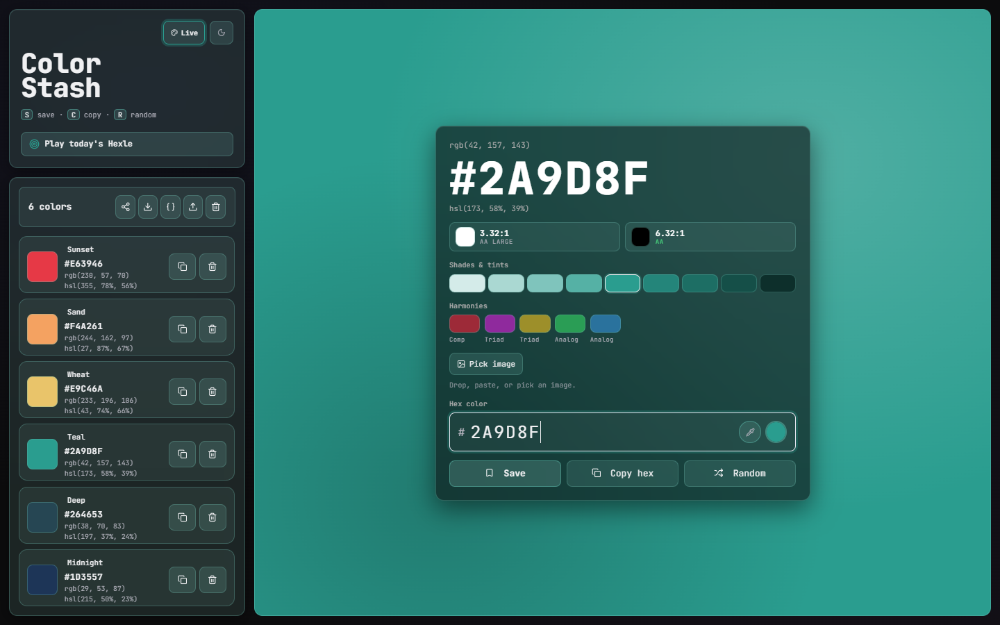

# 🎨 Color Stash

A private hex color tool for prototyping. Preview colors, check contrast, build
shades and harmonies, extract palettes from images, and keep a stash in your browser.

**Live:** [colorstash.kosta.lol](https://colorstash.kosta.lol/)



## Why

- **Lightweight & static**: plain HTML/CSS/JS, no build step, no framework.
- **Private**: no tracking, no accounts. Your palette lives in your browser's
  `localStorage` and never leaves the device.
- **Installable & offline**: a PWA with a service worker; make zero external
  network requests and works with no connection at all.
- **Deploy anywhere**: it's just files. GitHub Pages, Glitch, or any static host.

## Features

- Hex input with live validation, plus a native color picker
- **Live theme**: tint the whole interface with whatever color you have picked
- Big live preview with HEX / RGB / HSL readouts (click any value to copy)
- WCAG contrast ratings (against white and black, AA / AAA)
- Shades & tints strip generated from the current color
- Color harmonies (complementary, triadic, analogous), one click to apply
- Eyedropper to pick any color on screen (where supported)
- **Extract a palette from an image**: drop, paste, pick, or *share an image
  straight into the app* from your phone's share sheet; the dominant colors are
  read entirely on-device (canvas + median-cut) and the image is never uploaded
- Save, name, reorder (drag), copy, and delete colors from a personal stash
- Share a palette via a link (colors **and their names**, encoded in the URL hash)
- Export / import your palette (with names) as a JSON file, or copy it as
  developer tokens: **CSS variables, OKLCH, SCSS, Tailwind config, or W3C
  design-token JSON**
- Random color generator
- **Hexle**: a daily color guess. Everyone gets the same mystery color (seeded
  from the date, no server), pick its hex from five options, three wrong guesses
  lose the day. Streaks and a Wordle-style shareable result
- Three-way theme toggle: system · dark · light
- Toast notifications and smooth micro-animations (respects
  `prefers-reduced-motion`)
- Fully responsive, keyboard-accessible, installable as a PWA

## Run locally

No dependencies to install. Serve the folder with any static server, e.g.:

```sh
python -m http.server 8000
# then open http://localhost:8000
```

Opening `index.html` directly works too.

## Project structure

```
index.html               # markup, document head, inline SVG icon sprite
manifest.json            # PWA manifest
sw.js                    # service worker (cache-first, offline)
package.json             # only so `npm test` can run the color maths tests
src/css/styles.css       # all styling (custom-property theming)
src/js/color.js          # pure color math, no DOM, no state, unit-tested
src/js/main.js           # core app: DOM, storage, preview, stash plumbing
src/js/export-pack.js    # feature: developer token export menu
src/js/image-palette.js  # feature: on-device image → palette extraction
src/js/hexle.js          # feature: the daily Hexle game
tests/color.test.js      # node --test, no dependencies
src/assets/fonts/        # self-hosted JetBrains Mono (woff2)
src/assets/icons/        # PWA / app icons (PNG)
```

Each feature lives in its own file. They load as plain `<script defer>` after
`main.js` (no build step, no modules, so opening `index.html` over `file://`
still works) and take their dependencies from the `window.ColorStash` contract
that `main.js` publishes, rather than from bare globals.

`color.js` is separated out because it is the only part with no DOM or state in
it, which is what makes it testable. `main.js` touches the document at module
scope and cannot be required.

> **Deploy note:** the service worker precaches assets under `CACHE_NAME` in
> `sw.js`. Bump that version string whenever you change any cached file, so
> returning visitors pick up the new build instead of a stale cache.

## Tests

```sh
npm test        # node --test tests/color.test.js, no dependencies
```

Covers hex parsing and normalisation, HSL round-trips, WCAG contrast and grading,
the OKLab/OKLCH transform, the shade ramp mix, slug generation and the stash merge.
`hexle.js` and `image-palette.js` touch the DOM at module scope and are therefore
not covered yet.

## Roadmap

Planned improvements are tracked in [`IMPROVEMENTS.md`](./IMPROVEMENTS.md).

A working code review, prioritised backlog and round-by-round log live in
`.docs/` (untracked, local only).

## License

See [`LICENSE.md`](./LICENSE.md).
